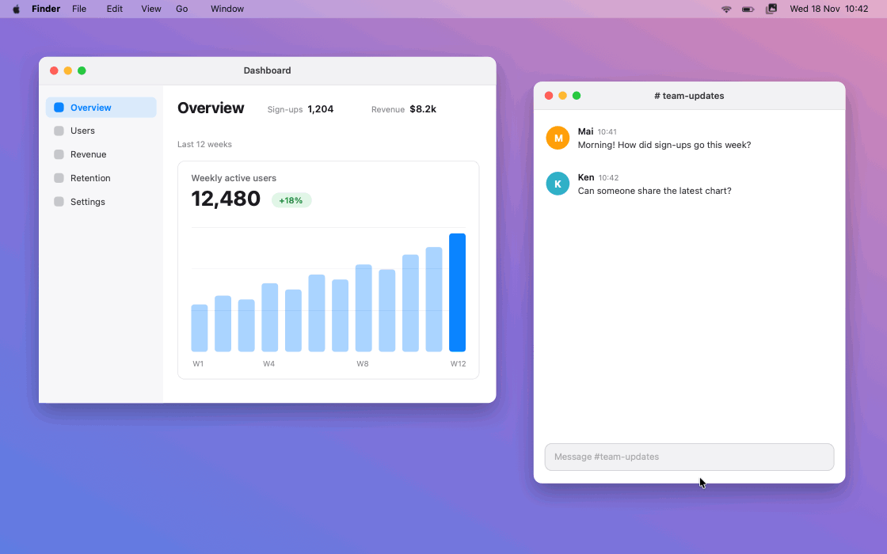
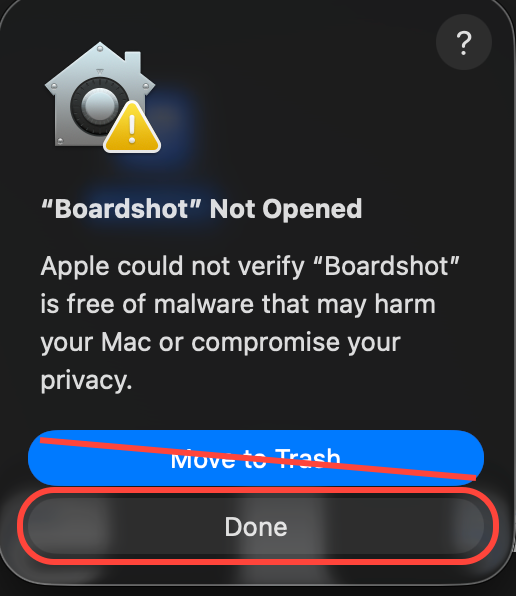

<div align="center">
  
  <h1>Boardshot</h1>
  <p><strong>Your recent screenshots, one shortcut away.</strong></p>

  <a href="https://github.com/phukijnat/boardshot/releases/latest/download/Boardshot.dmg"></a>

  [](https://github.com/phukijnat/boardshot/releases)
  
  [](LICENSE)

  English · [ภาษาไทย](README.th.md)
</div>

<p align="center"></p>

Take a screenshot the way you always do, press `⇧⌘Space`, and drag it straight into Slack, Figma, a chat or an issue. No digging through Finder. Boardshot lives in your menu bar, keeps every shot in one folder, and keeps your Desktop clean as a bonus.

> [!NOTE]
> **Beta.** Boardshot is new and still being tested. Things may break. Please [report bugs or ideas](https://github.com/phukijnat/boardshot/issues/new/choose).

## Features

- **Quick panel.** `⇧⌘Space` opens every shot: hover to preview, drag into any app, copy, or trash.
- **Same shortcuts, tidy Desktop.** `⌘⇧3`, `⌘⇧4` and `⌘⇧5` save to `~/Pictures/Boardshot` instead of the Desktop.
- **Instant files, same thumbnail tricks.** Boardshot's own corner thumbnail replaces the system one, so the file is saved right away. Click it to mark up a screenshot (the Mac's Markup) or trim a recording; right-click for the Mac's usual choices (save to Desktop, open in Preview, show in Finder, delete…).
- **Bring old ones in.** Screenshots your Mac left on the Desktop (say, taken while Boardshot was closed) show up as an **Import** button in the panel.
- **Undo anytime.** Your original screenshot settings are saved and put back when you untick one checkbox or quit the app.
- **Updates itself.** Tells you when a new version is out and installs it.
- **Private.** No account, no analytics. The only network request is the update check.
- Thai and English UI. Universal app for Apple Silicon and Intel, macOS 14 or later.

## Install

1. [Download **Boardshot.dmg**](https://github.com/phukijnat/boardshot/releases/latest/download/Boardshot.dmg) (always the newest version). Older versions are on the [Releases](https://github.com/phukijnat/boardshot/releases) page.
2. Open it and drag **Boardshot** into **Applications**.
3. Open Boardshot from Applications.
4. The first time it opens, a welcome window walks you through setup and asks before changing anything. You can see it again from **Settings → Show Welcome Again**.

### "Apple could not verify Boardshot…"
Boardshot isn't notarized by Apple (that needs a paid developer account), so macOS blocks it the first time. Click **Done**, not Move to Trash:



Then, once:

- **macOS 15 or later:** click **Done**, then double-click **Open Anyway** in the installer window (or open **System Settings → Privacy & Security**), scroll down and click **Open Anyway** next to Boardshot, then confirm.
- **macOS 14:** right-click Boardshot in Applications, choose **Open**, then click **Open** again.

Updates installed from inside the app don't need this step again.

## How to use

| Action | How |
|---|---|
| Open / close the panel | `⇧⌘Space` (change it in Settings) or click the camera icon in the menu bar |
| Preview a shot larger | Hover over it (can be turned off in Settings) |
| Select several | `⌘`-click, `⇧`-click, `⌘A`, or drag over empty space |
| Use a shot | Drag it into another app; the panel closes by itself |
| Copy | `⌘C` |
| Open in Preview | Double-click or `Return` |
| Move to Trash | `⌫` |
| Delete all | Trash button in the panel header (asks first) |
| Bring in screenshots from the Desktop | **Import N from Desktop** in the panel header, shown when there are any (asks first) |
| Move the panel | Drag the header |
| Close | `Esc` or click elsewhere |

The corner thumbnail after a capture:

| Action | How |
|---|---|
| Use it | Drag it into another app |
| Mark up a screenshot | Click it (opens the Mac's Markup; **Done** saves over the file) |
| Trim a recording | Click it, drag the yellow handles, then **Trim** |
| More (save a copy, open in Preview, show in Finder, delete…) | Right-click |
| Dismiss | Swipe right, or wait 5 seconds |

## Settings

Open from the menu bar icon → **Settings…**, the gear button in the panel, or `⌘,` while the panel is open.

- Shortcut to open the panel (must include `⌘`, `⌃` or `⌥`)
- Language: Thai / English
- Keep screenshots in Boardshot: on / off
- Thumbnail after capture: Boardshot's (instant file, click to mark up or trim, right-click for more), macOS (the Mac's own; the file arrives once the thumbnail goes away, and it may not appear on a second display), or none
- Larger preview when hovering a shot
- Open at login
- Show the menu bar icon
- Check for updates automatically, or **Check Now**
- **Show Welcome Again**: the first-launch window

## What Boardshot changes on your Mac

Boardshot asks first. If you say yes, it changes the same things you'd find under **Options** in `⇧⌘5`: screenshots are saved as files in `~/Pictures/Boardshot`, and the floating thumbnail is replaced by Boardshot's own (unless you keep the Mac's).

Your own settings are remembered and put back whenever you quit Boardshot or untick **Keep screenshots in Boardshot**. Nothing else on your Mac is touched.

<details>
<summary>Exactly which settings</summary>

Boardshot writes these keys in `com.apple.screencapture`:

| Key | Set to | Why |
|---|---|---|
| `location`, `location-screenshot`, `location-screenrecording` | `~/Pictures/Boardshot` | The save folder. macOS 27 is expected to read the last two. |
| `target`, `target-screenshot`, `target-screenrecording` | `file` | Captures sent to the clipboard or Preview never become a file Boardshot can see. |
| `show-thumbnail` | off, or on if you pick the Mac's thumbnail | The floating thumbnail. |

Nothing is restarted, so screenshots keep working while this happens. If Boardshot quits or crashes, the originals go back, so while it's closed your Mac saves screenshots the way it did before.

</details>

## FAQ

**Does it move the screenshots already on my Desktop?**
Only if you ask. When your old screenshot folder (usually the Desktop) holds screenshots or screen recordings, the welcome window offers to import them, and the panel shows **Import N from Desktop**. Importing moves them into `~/Pictures/Boardshot`. Only files your Mac made by capturing the screen are moved; everything else stays where it is.

**I already save screenshots to a custom folder. What happens to that setting?**
Boardshot remembers it and puts it back when you untick **Keep screenshots in Boardshot**.

**Does Boardshot send anything over the internet?**
Only the update check, which reads [`appcast.xml`](appcast.xml) from this repo. You can turn automatic checks off in Settings.

**Why isn't it notarized?**
Notarization needs a paid Apple developer account. The app is open source and you can [build it yourself](#feedback--contributing) (see **Build from source**).

## Uninstall

1. Quit Boardshot. This puts your screenshot settings back.
2. Move `/Applications/Boardshot.app` to the Trash.

Your screenshots stay in `~/Pictures/Boardshot`.

Deleted the app while it was running? Paste this into Terminal to go back to the Mac's default screenshot settings:

```bash
for k in location location-screenshot location-screenrecording target target-screenshot target-screenrecording show-thumbnail; do defaults delete com.apple.screencapture $k; done
```

## Feedback & contributing

Found a bug or have an idea? [Open an issue](https://github.com/phukijnat/boardshot/issues/new/choose). Pull requests are welcome too.

<details>
<summary>Build from source</summary>

Needs Xcode Command Line Tools (`xcode-select --install`). Xcode itself is optional.

```bash
git clone https://github.com/phukijnat/boardshot.git
cd boardshot
./build.sh
open build/Boardshot.app
```

`build.sh` downloads Sparkle (the update framework) into `vendor/` on first run and builds a universal app into `build/`. Use `./build.sh --install` to replace the copy in Applications instead.

Your own builds are signed ad hoc, so macOS may ask again for permissions, such as access to the Desktop when importing, after each rebuild.

[CONTRIBUTING.md](CONTRIBUTING.md) covers the code layout and how releases are made.

</details>

If Boardshot makes sharing screenshots feel instant, a ⭐ on the repo helps other people find it.

## Acknowledgements

- [Sparkle](https://sparkle-project.org) for in-app updates.

## License

Boardshot is free and open source under the [MIT License](LICENSE). © 2026 phukijnat

You're welcome to fork, change and share the code under that license. If you publish your own build, including on the Mac App Store, please give it a different name and icon so people can tell it apart. The name Boardshot and its icon are for the official app, which is only released from [this repo's Releases page](https://github.com/phukijnat/boardshot/releases).
