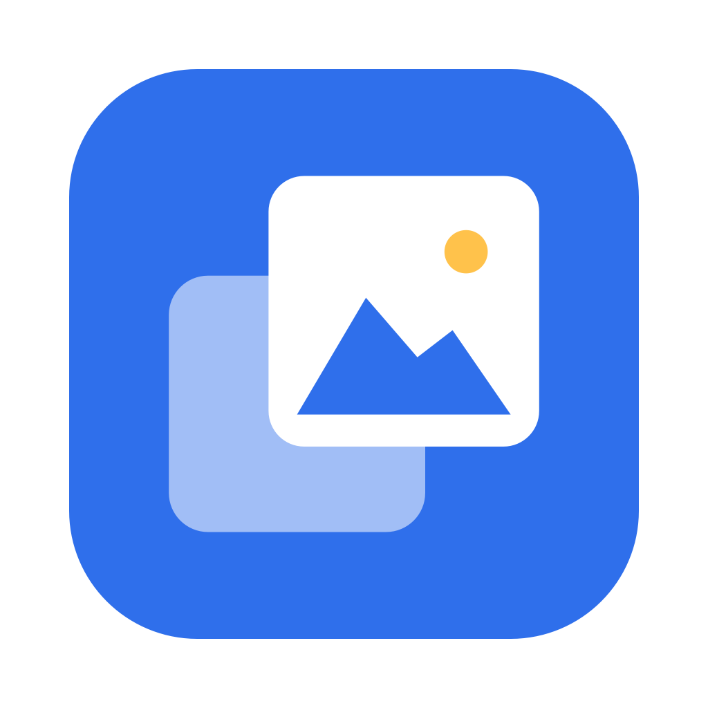
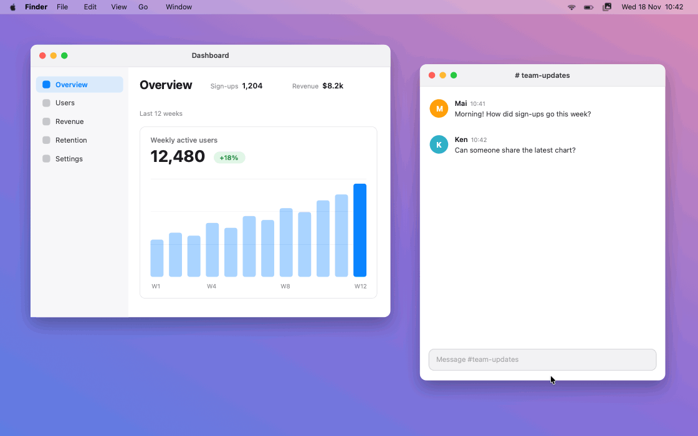
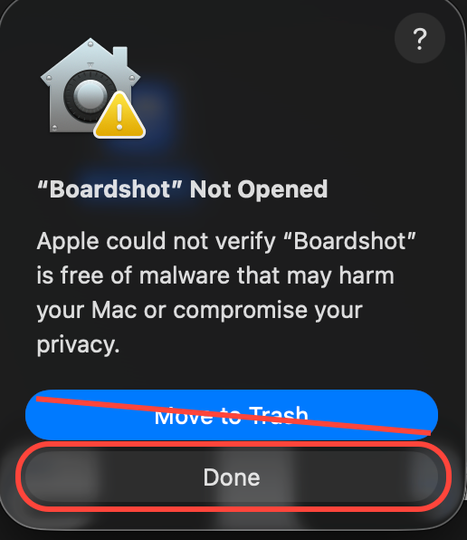

<div align="center">
  
  <h1>Boardshot</h1>
  <p><strong>screenshot ล่าสุด เรียกใช้ได้ด้วยคีย์ลัดเดียว</strong></p>

  <a href="https://github.com/phukijnat/boardshot/releases/latest/download/Boardshot.dmg"></a>

  [](https://github.com/phukijnat/boardshot/releases)
  
  [](LICENSE)

  [English](README.md) · ภาษาไทย
</div>

<p align="center"></p>

ถ่ายจอแบบที่ทำอยู่ทุกวัน กด `⇧⌘Space` แล้วลากภาพไปวางใน Slack, Figma, แชต หรือ issue ได้เลย ไม่ต้องเปิด Finder หาไฟล์ Boardshot อยู่บนแถบเมนู เก็บทุกภาพไว้ในโฟลเดอร์เดียว และได้ Desktop ที่สะอาดเป็นของแถม

> [!NOTE]
> **Beta** Boardshot ยังใหม่และอยู่ระหว่างทดสอบ อาจมีบั๊กได้ เจออะไร[แจ้งได้ที่นี่](https://github.com/phukijnat/boardshot/issues/new/choose)

## ความสามารถ

- **หน้าต่างเรียกใช้เร็ว** กด `⇧⌘Space` เห็นทุกภาพ ชี้เพื่อดูภาพใหญ่ ลากไปวางในแอปไหนก็ได้ คัดลอก หรือลบ
- **คีย์ลัดเดิม Desktop สะอาด** `⌘⇧3`, `⌘⇧4` และ `⌘⇧5` บันทึกไปที่ `~/Pictures/Boardshot` แทน Desktop
- **ไฟล์มาทันที ใช้รูปเล็กได้เหมือนของ Mac** รูปเล็กมุมจอของระบบถูกแทนด้วยของ Boardshot ไฟล์จึงเข้าโฟลเดอร์ทันที คลิกเพื่อขีดเขียนภาพ (Markup ของ Mac) หรือตัดวิดีโอ คลิกขวาเพื่อดูตัวเลือกแบบของ Mac (บันทึกไป Desktop, เปิดใน Preview, แสดงใน Finder, ลบ…)
- **ดึงภาพเก่าเข้ามา** ภาพแคปที่ค้างอยู่บน Desktop (เช่น แคปตอนปิดแอป) จะขึ้นเป็นปุ่ม **นำเข้า** ในหน้าต่าง
- **คืนค่าเดิมได้ทุกเมื่อ** แอปจำค่าเดิมของ Mac ไว้ และคืนให้เมื่อเอาติ๊กออกช่องเดียว หรือเมื่อปิดแอป
- **อัปเดตเอง** บอกเมื่อมีเวอร์ชันใหม่และติดตั้งให้
- **เป็นส่วนตัว** ไม่ต้องสมัครบัญชี ไม่เก็บสถิติ ออกอินเทอร์เน็ตแค่ตอนเช็กอัปเดต
- มีภาษาไทยและอังกฤษ ใช้ได้กับ macOS 14 ขึ้นไป ทั้งเครื่อง Apple Silicon และ Intel

## ติดตั้ง

1. [ดาวน์โหลด **Boardshot.dmg**](https://github.com/phukijnat/boardshot/releases/latest/download/Boardshot.dmg) (เป็นเวอร์ชันล่าสุดเสมอ) เวอร์ชันเก่าอยู่ที่หน้า [Releases](https://github.com/phukijnat/boardshot/releases)
2. เปิดไฟล์ แล้วลาก **Boardshot** ไปใส่ **Applications**
3. เปิด Boardshot จาก Applications
4. เปิดครั้งแรกจะมีหน้าต้อนรับพาตั้งค่า และถามก่อนเปลี่ยนอะไรทุกครั้ง เรียกดูอีกครั้งได้ที่ **ตั้งค่า → แสดงหน้าแนะนำอีกครั้ง**

### ถ้าขึ้นว่า "Apple could not verify Boardshot…"
Boardshot ยังไม่ได้ผ่านการตรวจ (notarize) ของ Apple เพราะต้องสมัครบัญชีนักพัฒนาแบบเสียเงิน macOS เลยบล็อกตอนเปิดครั้งแรก ให้กด **Done** อย่ากด Move to Trash:



จากนั้นทำแค่ครั้งเดียว:

- **macOS 15 ขึ้นไป:** กด **Done** แล้วดับเบิลคลิก **Open Anyway** ในหน้าต่างติดตั้ง (หรือไปที่ **System Settings → Privacy & Security** เอง) เลื่อนลงไปกด **Open Anyway** ข้าง Boardshot แล้วยืนยัน
- **macOS 14:** คลิกขวาที่ Boardshot ใน Applications เลือก **Open** แล้วกด **Open** อีกครั้ง

อัปเดตที่ติดตั้งจากในแอปไม่ต้องทำขั้นตอนนี้อีก

## วิธีใช้

| ทำอะไร | ทำยังไง |
|---|---|
| เปิด / ปิดหน้าต่าง | `⇧⌘Space` (เปลี่ยนได้ในหน้าตั้งค่า) หรือคลิกไอคอนกล้องบนแถบเมนู |
| ดูภาพใหญ่ | ชี้เมาส์ค้างบนรูป (ปิดได้ในหน้าตั้งค่า) |
| เลือกหลายรูป | `⌘`+คลิก, `⇧`+คลิก, `⌘A` หรือลากคลุมพื้นที่ว่าง |
| ใช้รูป | ลากออกไปวาง หน้าต่างจะหายไปเอง |
| คัดลอก | `⌘C` |
| เปิดด้วย Preview | ดับเบิลคลิก หรือ `Return` |
| ลบ (ย้ายไปถังขยะ) | `⌫` |
| ลบทั้งหมด | ปุ่มถังขยะบนแถบหัว (ถามยืนยันก่อน) |
| ดึงภาพจาก Desktop เข้ามา | ปุ่ม **นำเข้า N ไฟล์จาก Desktop** บนแถบหัว ขึ้นเมื่อมีภาพให้นำเข้า (ถามยืนยันก่อน) |
| ย้ายหน้าต่าง | ลากที่แถบหัว |
| ปิด | `Esc` หรือคลิกที่อื่น |

รูปเล็กที่มุมจอหลังแคป:

| ทำอะไร | ทำยังไง |
|---|---|
| ใช้รูป | ลากไปวางในแอปอื่น |
| ขีดเขียนบนภาพ | คลิก (เปิด Markup ของ Mac กด **Done** แล้วบันทึกทับไฟล์เดิม) |
| ตัดวิดีโอ | คลิก ลากแถบสีเหลือง แล้วกด **Trim** |
| อื่น ๆ (บันทึกสำเนา, เปิดใน Preview, แสดงใน Finder, ลบ…) | คลิกขวา |
| ปิด | ปัดไปทางขวา หรือรอ 5 วินาที |

## ตั้งค่า

เปิดได้ 3 ทาง: ไอคอนกล้องบนแถบเมนู → ตั้งค่า…, ปุ่มเฟืองในหน้าต่าง Boardshot หรือกด `⌘,` ตอนหน้าต่างเปิดอยู่

- คีย์ลัดเปิดหน้าต่าง (ต้องมี `⌘`, `⌃` หรือ `⌥` อย่างน้อยหนึ่งตัว)
- ภาษา: ไทย / English
- เก็บ screenshot ไว้ที่ Boardshot: เปิด/ปิด
- รูปเล็กหลังถ่าย: ของ Boardshot (ไฟล์เข้าทันที คลิกเพื่อขีดเขียนหรือตัดวิดีโอ คลิกขวาดูตัวเลือกอื่น), ของ macOS (รูปเล็กแบบเดิมของ Mac ไฟล์เข้าหลังรูปเล็กหายไป และอาจไม่ขึ้นบนจอที่สอง) หรือไม่แสดง
- แสดงภาพใหญ่เมื่อชี้เมาส์ค้างบนรูป
- เปิดอัตโนมัติตอนเข้าเครื่อง
- แสดงไอคอนบนแถบเมนู
- ตรวจหาอัปเดตอัตโนมัติ หรือกด **ตรวจเดี๋ยวนี้**
- **แสดงหน้าแนะนำอีกครั้ง**: หน้าต้อนรับตอนเปิดครั้งแรก

## Boardshot เปลี่ยนอะไรในเครื่อง

Boardshot ถามก่อนเสมอ ถ้าคุณตกลง แอปจะเปลี่ยนค่าเดียวกับที่อยู่ใน **Options** ของ `⇧⌘5` คือบันทึกภาพเป็นไฟล์ไว้ที่ `~/Pictures/Boardshot` และใช้รูปเล็กมุมจอของ Boardshot แทนของระบบ (ถ้าไม่ได้เลือกใช้ของ Mac)

ค่าเดิมของคุณถูกจำไว้ และคืนให้ทุกครั้งที่ปิด Boardshot หรือเอาติ๊ก "เก็บ screenshot ไว้ที่ Boardshot" ออก แอปไม่แตะอย่างอื่นในเครื่อง

<details>
<summary>ค่าที่เปลี่ยนทั้งหมด</summary>

Boardshot เขียนค่าเหล่านี้ใน `com.apple.screencapture`:

| ค่า | ตั้งเป็น | เพื่ออะไร |
|---|---|---|
| `location`, `location-screenshot`, `location-screenrecording` | `~/Pictures/Boardshot` | โฟลเดอร์เก็บภาพ คาดว่า macOS 27 จะใช้สองตัวหลัง |
| `target`, `target-screenshot`, `target-screenrecording` | `file` | ภาพที่ส่งไป clipboard หรือ Preview จะไม่กลายเป็นไฟล์ Boardshot จึงมองไม่เห็น |
| `show-thumbnail` | ปิด หรือเปิดถ้าคุณเลือกใช้รูปเล็กของ Mac | รูปเล็กลอยมุมจอ |

ไม่ต้องรีสตาร์ตอะไร แคปจอได้ตลอดระหว่างเปลี่ยน ถ้า Boardshot ปิดหรือ crash ค่าเดิมจะกลับมา ระหว่างที่แอปปิดอยู่ Mac จึงเก็บภาพแบบที่เคยตั้งไว้

</details>

## คำถามที่พบบ่อย

**ภาพที่อยู่บน Desktop อยู่แล้วจะถูกย้ายไหม?**
ย้ายเฉพาะเมื่อคุณสั่ง ถ้าโฟลเดอร์เก็บภาพเดิม (ปกติคือ Desktop) มีภาพหรือวิดีโอที่แคปไว้ หน้าต้อนรับจะถามว่าจะนำเข้าไหม และหน้าต่าง Boardshot จะขึ้นปุ่ม **นำเข้า N ไฟล์จาก Desktop** การนำเข้าคือย้ายไฟล์ไปไว้ที่ `~/Pictures/Boardshot` ย้ายเฉพาะไฟล์ที่ Mac สร้างจากการแคปหน้าจอ ไฟล์อื่นอยู่ที่เดิม

**ถ้าเคยตั้งโฟลเดอร์เก็บ screenshot เองไว้ จะเป็นยังไง?**
Boardshot จำค่านั้นไว้ และคืนให้เมื่อเอาติ๊ก "เก็บ screenshot ไว้ที่ Boardshot" ออก

**Boardshot ส่งอะไรออกอินเทอร์เน็ตไหม?**
มีแค่การเช็กอัปเดต ซึ่งอ่านไฟล์ [`appcast.xml`](appcast.xml) จาก repo นี้ ปิดการเช็กอัตโนมัติได้ในหน้าตั้งค่า

**ทำไมยังไม่ผ่าน notarize?**
ต้องใช้บัญชีนักพัฒนา Apple แบบเสียเงิน แอปนี้เป็นโอเพนซอร์ส [build เองได้](#แจ้งปัญหาและร่วมพัฒนา) (ดูหัวข้อ **Build เอง**)

## ลบแอป

1. ออกจาก Boardshot ค่า screenshot จะกลับเป็นแบบเดิมเอง
2. ย้าย `/Applications/Boardshot.app` ไปถังขยะ

รูปที่ถ่ายไว้ยังอยู่ที่ `~/Pictures/Boardshot`

ลบแอปไปตอนที่ยังเปิดอยู่? วางคำสั่งนี้ใน Terminal เพื่อกลับไปใช้ค่าตั้งต้นของ Mac:

```bash
for k in location location-screenshot location-screenrecording target target-screenshot target-screenrecording show-thumbnail; do defaults delete com.apple.screencapture $k; done
```

## แจ้งปัญหาและร่วมพัฒนา

เจอบั๊กหรือมีไอเดีย [เปิด issue ได้เลย](https://github.com/phukijnat/boardshot/issues/new/choose) ส่ง Pull Request ได้เช่นกัน

<details>
<summary>Build เอง</summary>

ต้องมี Xcode Command Line Tools (`xcode-select --install`) ไม่จำเป็นต้องมี Xcode

```bash
git clone https://github.com/phukijnat/boardshot.git
cd boardshot
./build.sh
open build/Boardshot.app
```

ครั้งแรก `build.sh` จะโหลด Sparkle (ระบบอัปเดต) มาไว้ที่ `vendor/` แล้ว build แอปไว้ที่ `build/` ถ้าอยากให้ติดตั้งทับตัวใน Applications เลย ใช้ `./build.sh --install`

แอปที่ build เองเซ็นแบบ ad hoc ทุกครั้งที่ build ใหม่ macOS อาจถามสิทธิ์ซ้ำ เช่น สิทธิ์เข้าถึง Desktop ตอนนำเข้าภาพ

โครงสร้างโค้ดและวิธีปล่อยเวอร์ชันดูใน [CONTRIBUTING.md](CONTRIBUTING.md)

</details>

ถ้า Boardshot ทำให้ส่ง screenshot ได้ไวขึ้น กด ⭐ ให้ repo จะช่วยให้คนอื่นเจอแอปนี้ง่ายขึ้น

## ขอบคุณ

- [Sparkle](https://sparkle-project.org) สำหรับระบบอัปเดตในแอป

## License

Boardshot เป็นซอฟต์แวร์ฟรีและโอเพนซอร์ส ภายใต้ [MIT License](LICENSE) © 2026 phukijnat

ใครจะ fork แก้ไข หรือแจกต่อก็ได้ตามเงื่อนไขของ MIT แต่ถ้าเผยแพร่เวอร์ชันของตัวเอง รวมถึงลงใน Mac App Store ขอให้ใช้ชื่อและไอคอนอื่น คนจะได้แยกออกว่าตัวไหนเป็นตัวจริง ชื่อ Boardshot และไอคอนสงวนไว้สำหรับแอปทางการ ซึ่งปล่อยที่ [หน้า Releases ของ repo นี้](https://github.com/phukijnat/boardshot/releases) ที่เดียวเท่านั้น
